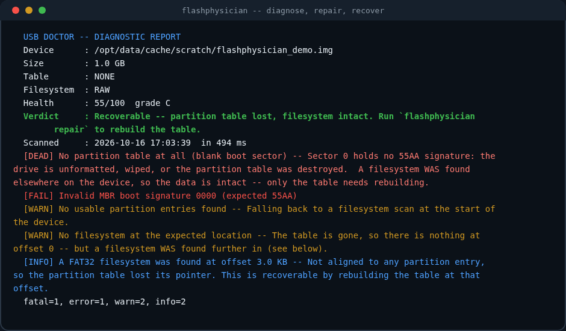

<div align="center">


**Rescue tool for USB flash drives, SD cards and memory cards.**

Reads the drive before it writes to it. Shows you the plan before it acts.
Backs up every sector it overwrites.


</div>

---

## The problem this solves

A flash drive fails and there is usually no sign of *what* failed. Windows says
the disk is **RAW**, or the drive shows up with **0 bytes**, or the files are
simply **gone**. Every one of those has a different cause, a different fix and a
different chance of getting your data back — and the tools that could tell them
apart are scattered across a dozen half-maintained projects.

FlashPhysician reads the actual bytes on the medium — the MBR, the GPT, the FAT
tables, the exFAT boot region, the `$MFT` — and tells you *which* of these
things happened:

| What you see | What is usually wrong | What FlashPhysician does |
|---|---|---|
| **"Disk is not formatted. Do you want to format it?"** | Partition table lost or boot signature gone. The data is still there. | Rebuilds the table from the filesystem it finds on the drive |
| **Drive shows as RAW** | FAT label contradicts the real geometry, or exFAT checksum broken | Corrects the boot sector, rebuilds the exFAT boot region |
| **Files vanished** | Deleted directory entries, hidden attribute, or **fake capacity** | Recovers the deleted entries; detects fraudulent flash |
| **0 bytes / no drive letter** | Controller or partition-table fault | Identifies it as hardware, or rebuilds the table |
| **"The disk is write-protected"** | Software write-protect flag, no physical switch | Clears the flag (Windows) |
| **Files come back corrupted** | Failing flash cells that no longer hold a charge | Surface-tests every sector and reports the bad ones |

It does **not** guess. Every claim in the report is backed by a byte offset it
read.

---

## Try it

### Windows — portable, nothing to install

Download `FlashPhysician-portable-win64.exe` from
[Releases](https://github.com/Rasfooo/flashphysician/releases) and run it. No Python,
no runtime, no installer. It is a single file you can keep on the very drive
you are rescuing.

> Windows will show a SmartScreen warning for any newly published unsigned
> executable. Choose **More info → Run anyway**, or build it yourself from
> source (see below) if you would rather not trust a download.

### Linux

```bash
git clone https://github.com/Rasfooo/flashphysician
cd flashphysician
python3 -m flashphysician diagnose /dev/sdb
```

No installation step — the package has **zero dependencies**. Tkinter ships with
Python, and every OS-level helper (`chkdsk`, `fsck.fat`, `diskpart`, `ntfsfix`)
is invoked as a subprocess; if one is missing, FlashPhysician says so instead of
failing.

Optional helpers, if you want the corresponding features:

```bash
sudo apt install dosfstools exfatprogs ntfs-3g   # FAT / exFAT / NTFS repair
```

### Python package

```bash
pip install git+https://github.com/Rasfooo/flashphysician
flashphysician --help
flashphysician-gui
```

---

## What it looks like



Real output from a drive whose partition table was wiped — the single most
common state for a flash drive that was unplugged mid-write. Notice it does not
say "unrecoverable": it found the filesystem elsewhere on the medium and says so.

---

## Commands

```
flashphysician list                    # show removable drives
flashphysician info                    # what this system can do
flashphysician diagnose <device>       # read-only health report
flashphysician scan <device>           # surface test: find bad sectors
flashphysician capacity <device>       # detect fake / overreported flash
flashphysician repair <device>         # rebuild partition table / boot sector
flashphysician fix <device>            # run the OS filesystem checker
flashphysician recover <device> --to DIR   # recover files
flashphysician image <device> --to FILE    # copy the drive, tolerating bad sectors
flashphysician eject <device>          # flush and safely remove
```

Every destructive command is safe by default. `repair`, `scan` and `capacity`
print exactly what they would write and stop, unless you pass `--yes`:

```bash
$ flashphysician repair /dev/sdb
  [2] rebuild partition table pointing at the filesystem at 1.0 MB
      - rebuild MBR: FAT32 partition @ LBA 2048 (30253056 sectors)
      note: volume label preserved: 'BACKUP'
      WARNING: This writes ONLY sector 0. The filesystem and all files are
               untouched -- if the result is wrong, restore sector 0 from the
               backup this plan creates.

  1 step(s) ready to apply. Nothing has been written yet.
  Re-run with --yes to apply.
```

### Exit codes (safe to script)

| Code | Meaning |
|---|---|
| 0 | Success |
| 1 | Nothing to do / nothing found |
| 2 | Bad usage, missing device, unsafe destination |
| 3 | Filesystem errors found (read-only check) |
| 4 | Fake capacity detected |
| 5 | A repair step failed |
| 70 | Unexpected internal error |

---

## Safety model

This tool writes to the drive that holds the only copy of your data, so the
defaults are chosen accordingly.

- **Diagnosis never writes.** `diagnose` only reads metadata. It is safe on a
  drive that is already dying.
- **Repairs are planned before they are applied.** A repair is a list of
  concrete byte writes with offsets, shown to you first. `--yes` is required.
- **Every overwritten sector is backed up** to `~/.flashphysician/backups/` before
  the write, so a repair is undoable.
- **`--dry-run` is the default.** `plan.apply(dry_run=True)` produces the
  identical plan and touches nothing.
- **Recovery never writes to the source.** Recovered files always go to a
  destination directory, and the tool refuses a destination inside the drive
  being recovered.
- **Whole block devices are refused** unless `--force` is passed, so a mistyped
  `/dev/sda` cannot silently wipe your system disk.
- **Fake capacity is destructive by nature** — quantifying it requires writing.
  The tool says so before it starts and only proceeds with `--yes`.

---

## Diagnostics it understands

Verified by the test suite against byte-exact images of each failure.

**Partition tables**
- MBR: signature, CHS sanity, entry overlap, out-of-bounds partitions, illegal
  status bytes, protective-MBR handling, hybrid GPT layouts
- GPT: primary header CRC32, backup header CRC32, partition-entry-array CRC32,
  backup at the wrong LBA, GPT without a backup, protective-MBR-only drives with
  a recoverable backup
- **Orphaned filesystems**: a filesystem that no partition entry points at. The
  data is intact and the fix is a table rebuild, not a recovery.

**FAT12 / FAT16 / FAT32**
- Boot sector geometry, FAT-corrupt detection, missing media descriptor
- Both FAT copies compared byte-for-byte
- **Type/geometry mismatch**: the label says FAT32 but the cluster count says
  FAT16. This is why Windows shows a physically fine drive as RAW, and the fix
  is one byte.
- FAT32 backup boot sector compared against the primary
- FSInfo validation, clean-shutdown and hard-error flags in FAT[1]
- Clusters marked bad, FAT entries pointing outside the data region
- Wrong `root_entries`/`total_sectors` combinations that imply a different type

**exFAT**
- Boot region checksum (the rotate-xor over 11 sectors, skipping the flag bytes)
- Backup boot region at the end of the volume, and whether it agrees
- FAT region readability, volume dirty flag, bogus sector/cluster shifts

**NTFS**
- Boot signature, `$MFT` location and `FILE` record signature, cluster size

**The medium itself**
- Write-read-verify over any range, reporting the exact failing offsets
- **Fake-capacity detection** using the F3 method: write a marker encoding its
  own offset everywhere, read it back, and locate where writes start aliasing.
  The report names the real capacity, not just "something is wrong".

---

## Recovering files

Four lines of defence, in the order they are tried:

1. **Live directory entries** — normal files, read through the FAT chain
   (`multicluster` files are reassembled by following the chain, not by assuming
   clusters are contiguous).
2. **Deleted entries** — FAT marks a deleted file by overwriting the first
   character of its name with `0xE5`. The clusters are usually still intact and
   contiguous, so the content comes back; the first letter of the name cannot,
   and FlashPhysician says so rather than inventing one.
3. **Hidden files** — an attribute byte, not a missing file.
4. **Signature carving** — when there is no filesystem left at all, scan for
   known file headers (JPEG, PNG, GIF, PDF, ZIP, RTF, MP3, WAV, MKV, OGG,
   SQLite, OLE/Office) and reconstruct. Carving recovers *content without names
   or folders*, and truncates any file whose fragments are not contiguous. The
   report states this instead of quietly producing broken files.

```bash
flashphysician recover /dev/sdb --to ~/rescued            # easy cases
flashphysician recover /dev/sdb --to ~/rescued --carve    # when nothing is left
```

---

## If the drive is dying

Read it once, then stop touching it:

```bash
flashphysician image /dev/sdb --to ~/sdb.img
```

Unreadable blocks are recorded and zero-filled so the copy can continue, and the
exact offsets are listed. Work on the image from then on — every further read of
a failing drive makes it worse, and a rescue tool that keeps poking it is
destroying the thing it is trying to save.

---

## Building the Windows .exe

The release executables are built on Windows by
[`.github/workflows/build-exe.yml`](.github/workflows/build-exe.yml), so the
artefact is a genuine Windows build rather than a cross-compiled guess:

```bat
pip install pyinstaller
python tools\make_logo.py
python tools\make_ico.py
pyinstaller tools\flashphysician.spec --noconfirm
```

Output: `dist/FlashPhysician/` (windowed), `dist/FlashPhysician-portable.exe` (single
file), `dist/flashphysician-cli/` (console build for scripting).

---

## Development

```bash
python3 tests/test_engine.py     # structure parsing        23 tests
python3 tests/test_repair.py     # repair round-trips       10 tests
python3 tests/test_surface.py    # surface + capacity        7 tests
python3 tests/test_recovery.py   # file recovery            10 tests
python3 tests/test_cli.py        # CLI contract             15 tests
python3 tests/test_gui.py        # GUI (headless)            9 tests
python3 tests/run_all.py         # everything
```

**74 tests, all passing.** They are plain scripts with no test framework
required, because a rescue tool has to be verifiable on a machine where you
cannot install anything.

The tests are not smoke tests. They build byte-exact images of each failure mode
and assert on the diagnostic code *and* the health verdict — and the repair
tests are end-to-end: break an image, plan, apply, then re-diagnose and require
the fault to be gone and the recovered bytes to equal the original payload.

Because `mkfs` may be unavailable and `losetup` needs root, every fixture is
written byte-for-byte in Python (`tests/fixtures.py`). That is a feature: each
image encodes exactly the corruption under test, including states that are hard
to produce on real hardware — a FAT32 label on FAT16 geometry, a wrapping
capacity, a stuck-at-zero sector.

### Not covered by the automated tests

Honest limits, so you know what to verify yourself:

- **The GUI is not rendered in CI.** Tkinter needs an X display; the test suite
  covers compilation, method-signature sanity, the advice engine, and the repair
  selection logic, but widget layout was checked by hand.
- **Windows-specific paths** (`chkdsk`, `diskpart`, `Clear-Disk`) are built as
  argv lists and unit-reviewed, but need a Windows machine to execute.
- **Filesystem repair tools are absent in the test container**, so `fsck` /
  `chkdsk` invocation is verified structurally, not executed.

---

## Project layout

```
flashphysician/
  core/
    structures.py   on-disk formats: MBR, GPT, FAT, exFAT, NTFS, ext
    imaging.py      device/image source, discovery, tolerant copying
    diagnose.py     the engine: findings, health score, verdict
    repair.py       repair plans, safety guards, atomic apply + backup
  recovery/
    files.py        directory walking, deleted/hidden recovery, carving
    surface.py      write-read-verify, fake-capacity detection
  backends/
    base.py         capability probing, argv-only command runner
    linux.py        fsck.fat / e2fsck / ntfsfix / udisksctl / badblocks
    windows.py      chkdsk / diskpart / Clear-Disk / mountvol / write-protect
  cli.py            command line interface
  gui.py            Tkinter desktop app
tests/              fixtures + 74 tests, no framework required
tools/              logo generator, .ico builder, PyInstaller spec
```

---

## Contributing

Issues and pull requests are welcome. A few things that help:

**Report a bug** — open an [issue](https://github.com/Rasfooo/flashphysician/issues)
with:

- What you ran (exact command)
- What you expected, what happened instead
- The `diagnose` output (it never writes, so it is safe to run on a dying drive)
- Your OS and Python version

Please **do not** attach raw disk images — they contain your data. A
`diagnose --json` report is enough for most bug reports.

**Reproduce a failure** — the test suite builds byte-exact images of each
failure mode in `tests/fixtures.py`. If you hit a case it does not cover, a
new fixture plus an assertion is the most useful contribution.

**Add a diagnostic** — every check lives in
`flashphysician/core/diagnose.py` as a `Finding` with a stable code. The health
score, verdict and repair plan all derive from those codes, so a new check is
a single place to touch.

**Run the tests**

```bash
python3 tests/run_all.py    # 74 tests, no framework required
```

Code style is plain PEP 8 with type hints. Keep the safety model: diagnosis
must never write, and every write must be plannable, shown and backed up.

---

## Credits

FlashPhysician exists because a lot of good work already did. It stands on:

- **[AltraMayor/f3](https://github.com/AltraMayor/f3)** — the standard method for
  detecting fraudulent flash. The capacity test here follows its principle:
  write a marker that encodes its own address, then find where reads stop
  agreeing.
- **[whitslack/flakyflash](https://github.com/whitslack/flakyflash)** — for the
  distinction between *flaky* media (sectors that stop holding charge) and *fake*
  media (capacity that does not exist). Both are diagnosed here, separately.
- **[cgsecurity/testdisk](https://github.com/cgsecurity/testdisk)** — the
  reference implementation for partition and file recovery; the orphan-filesystem
  workflow follows its approach.
- **[zougar99/USB-diagnostic-tool-](https://github.com/zougar99/USB-diagnostic-tool-)**
  and **[Sk1n2/FluxDisk](https://github.com/Sk1n2/FluxDisk)** — prior art for a
  unified USB repair GUI; their feature sets informed what belongs in one.
- **[n-romanovich/usb-test](https://github.com/n-romanovich/usb-test)** — sector
  integrity verification.
- The **Microsoft FAT/exFAT specifications** and the **UEFI GPT specification** —
  the byte layouts implemented in `structures.py` come straight from them.

## License

MIT — see [LICENSE](LICENSE). Use it, ship it, fix it.

*If this saved your data, a ⭐ helps someone else find it.*